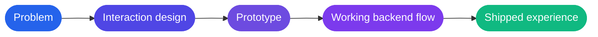

 

  

<a href="https://winnowhq.com"><b>Winnow</b></a> &nbsp;•&nbsp;
<a href="https://www.intentionalworshippers.live"><b>Intentional Worshippers</b></a> &nbsp;•&nbsp;
<a href="https://linkedin.com/in/ayomide-olabisi-88190120b"><b>LinkedIn</b></a> &nbsp;•&nbsp;
<a href="mailto:ayortechservice@gmail.com"><b>Email</b></a>

 

## About me

I take a product from idea to frontend polish to a working backend flow. My work sits across product thinking, user experience, and AI-assisted execution, with a bias toward systems that help people make decisions faster.

I care about clean interfaces, useful workflows, and tools that feel direct and dependable. I am strongest when I can shape the problem, define the interaction, and move quickly from prototype to shipped experience.

> [!NOTE]
> Open to full-time roles and freelance projects. The fastest way to reach me is email.

## How I work

<table>
  <tr>
    <td valign="top" width="33%">
      <h4>Product thinking</h4>
      Shaping the problem first, then building the smallest thing that proves it works.
    </td>
    <td valign="top" width="33%">
      <h4>Interface craft</h4>
      Clean, direct interfaces and user flows that feel dependable from the first click.
    </td>
    <td valign="top" width="33%">
      <h4>AI workflows</h4>
      Research, automation, and decision tools that help people move faster.
    </td>
  </tr>
</table>

## Tech stack

  

## Featured projects

<table>
  <tr>
    <td valign="top" width="50%">
      <h3>Winnow</h3>
      
Buyer-intelligence product for Reddit-based market research and lead discovery.

      
<code>TypeScript</code> <code>Next.js</code> <code>React</code> <code>Drizzle</code> <code>Neon</code> <code>Anthropic SDK</code> <code>Vercel</code>

      
<a href="https://winnowhq.com"><b>Live product →</b></a>

    </td>
    <td valign="top" width="50%">
      <h3>verified-remote-jobs</h3>
      
Python pipeline that filters the noise and surfaces vetted remote work opportunities.

      
<code>Python</code> <code>Automation</code> <code>Data collection</code>

      
<a href="https://github.com/AyorN-cyber/verified-remote-jobs"><b>Repository →</b></a>

    </td>
  </tr>
  <tr>
    <td valign="top" width="50%">
      <h3>Intentional Worshippers</h3>
      
Modern community website for a faith-centered brand and digital content experience.

      
<code>Next.js</code> <code>TypeScript</code> <code>Product website</code>

      
<a href="https://www.intentionalworshippers.live"><b>Live site →</b></a>

    </td>
    <td valign="top" width="50%">
      <h3>Brand workspace platform</h3>
      
Workspace-style web app for a brand platform with admin, auth, and content structure.

      
<code>React</code> <code>Vite</code> <code>TypeScript</code> <code>Supabase</code> <code>Tailwind</code>

      
Private client work. Walkthrough on request.

    </td>
  </tr>
  <tr>
    <td valign="top" width="50%">
      <h3>Desktop AI automation app</h3>
      
Desktop app with bring-your-own-key security and browser-agent capabilities.

      
<code>TypeScript</code> <code>AI tooling</code> <code>Secure automation</code> <code>Browser workflows</code>

      
Private work. Walkthrough on request.

    </td>
    <td valign="top" width="50%">
      <h3>Client mobile and portal suite</h3>
      
Client-facing mobile and portal experiences across product flows, dashboards, and internal service tooling.

      
<code>React Native</code> <code>Expo</code> <code>TypeScript</code> <code>Node</code>

      
Private client work. Walkthrough on request.

    </td>
  </tr>
</table>

  
<b>More work</b>

   

- Landing pages and conversion-focused frontend builds for brand and service sites.
- Product prototypes and internal tooling for workflow automation and UI experimentation.

## Journey

| Period | Focus |
| :-- | :-- |
| **2024** | Frontend-heavy product experiences and marketing sites, shaping user flows, content structure, and visual polish. |
| **2024 to 2025** | Application work with admin, auth, and content-driven systems, blending UI design with working app logic. |
| **2025 to 2026** | AI-assisted product work: customer research workflows, secure automation patterns, and browser-driven execution tooling. |
| **Now** | Shipping product experiences and internal AI tooling, with a focus on clarity, technical execution, and practical results. |

## Currently working on

- Product systems around AI-assisted research and lead discovery.
- Secure, practical browser automation patterns for real work flows.
- Frontend product judgment and TypeScript architecture across customer-facing work.

## Activity

  

## Let's talk

