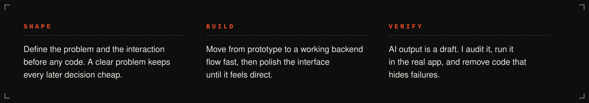

<a href="https://winnowhq.com"><b>Products</b></a> &nbsp;/&nbsp;
<a href="https://winnowhq.online"><b>Studio</b></a> &nbsp;/&nbsp;
<a href="https://www.intentionalworshippers.live"><b>Community site</b></a> &nbsp;/&nbsp;
<a href="https://linkedin.com/in/ayomide-olabisi-88190120b"><b>LinkedIn</b></a> &nbsp;/&nbsp;
<a href="mailto:ayortechservice@gmail.com"><b>Email</b></a>

I take a product from idea to frontend polish to a working backend flow. My work sits across product thinking, user experience and AI-assisted execution, with a bias toward systems that help people make decisions faster.

I work as a solo builder who directs AI the way a lead directs a team, so I spend as much time evaluating and hardening what it produces as I do shaping it. The work below mixes products I own with systems I built for clients.

 

 

 

 

<a href="mailto:ayortechservice@gmail.com">ayortechservice@gmail.com</a> &nbsp;/&nbsp;
<a href="https://linkedin.com/in/ayomide-olabisi-88190120b">LinkedIn</a> &nbsp;/&nbsp;
<a href="https://github.com/AyorN-cyber">GitHub</a> &nbsp;/&nbsp;
<a href="https://winnowhq.online">winnowhq.online</a>

