
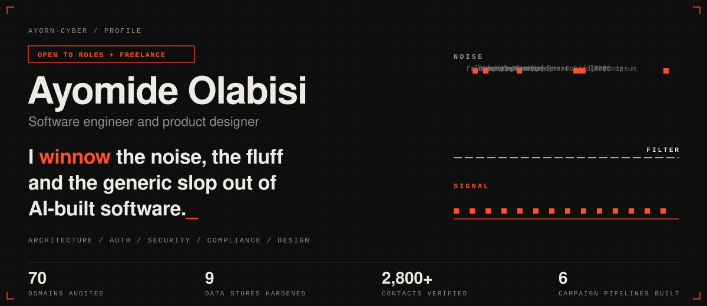

<a href="https://winnowhq.com"><b>Products</b></a> &nbsp;/&nbsp;
<a href="https://winnowhq.online"><b>Studio</b></a> &nbsp;/&nbsp;
<a href="https://www.intentionalworshippers.live"><b>Community site</b></a> &nbsp;/&nbsp;
<a href="https://linkedin.com/in/ayomide-olabisi-88190120b"><b>LinkedIn</b></a> &nbsp;/&nbsp;
<a href="mailto:ayortechservice@gmail.com"><b>Email</b></a>

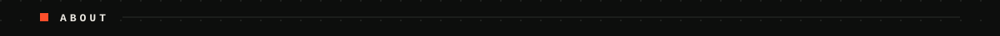

I am a software engineer and product designer. My job is to winnow out the noise, the fluff and the generic slop that AI produces, and keep what is real.

AI can now produce an app in an afternoon, and a lot of those apps fail review: weak authentication, exposed data, leaked secrets, missing compliance, and interfaces that look like every other build. I do the engineering that comes after the prompt. I assess the system, design the architecture, build it properly, and prove that authentication, security and compliance hold.

Design is as much my work as code. I take a product from idea to interface to a working backend flow, and I direct AI across all of it, from research to programming to UI design.

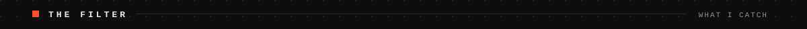

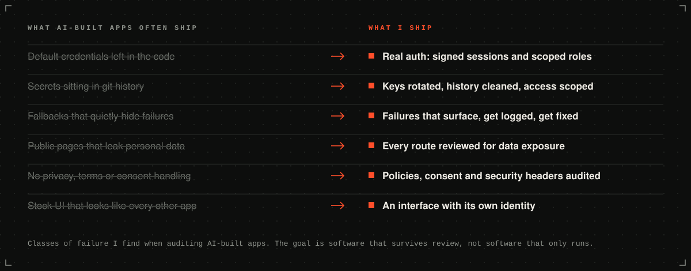

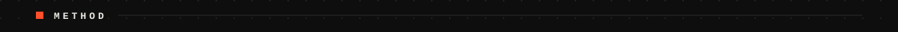

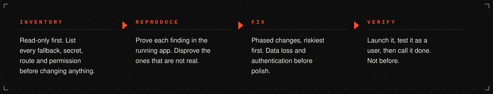

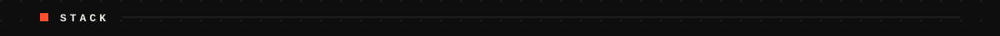

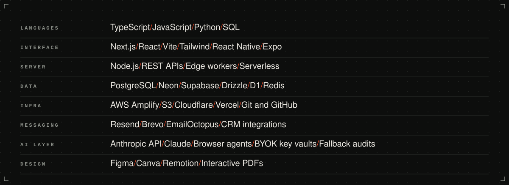

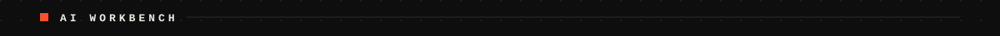

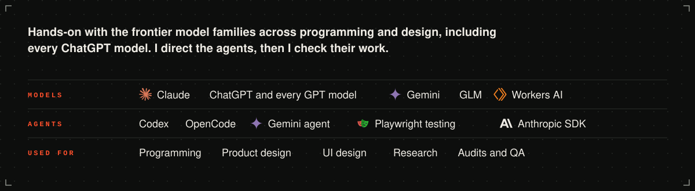

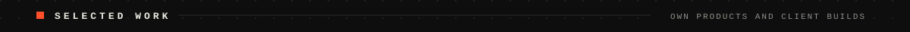

<a href="https://winnowhq.com">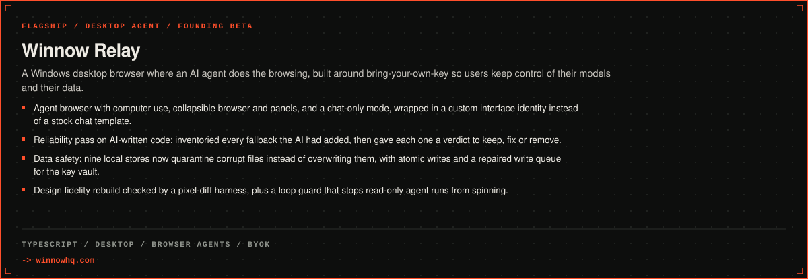</a>

<a href="https://winnowhq.com">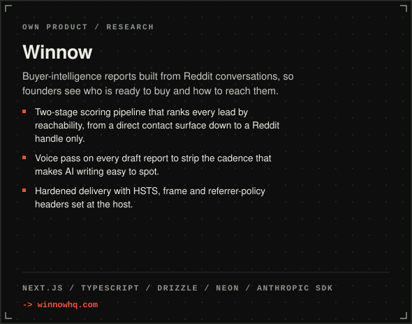</a> 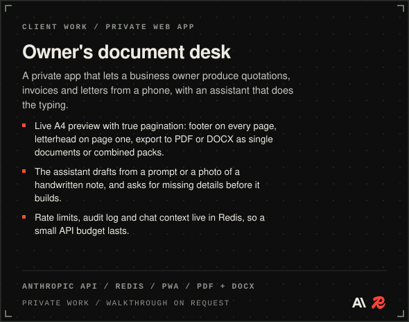

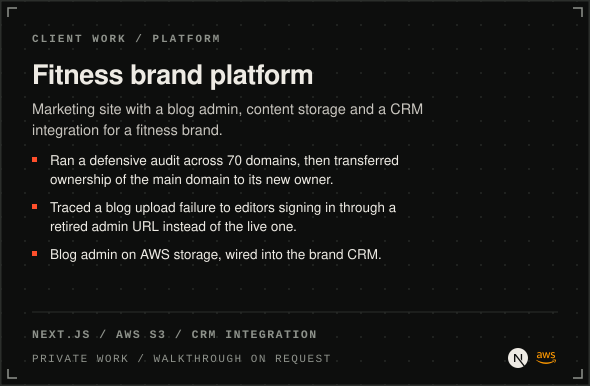 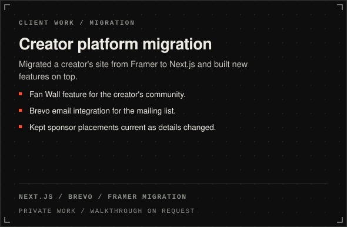

<a href="https://intentionalworshippers.live">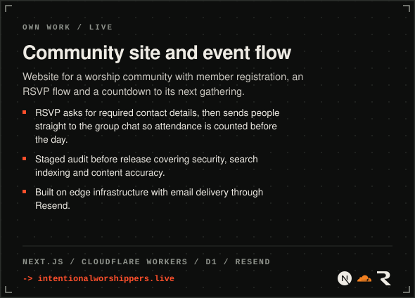</a> 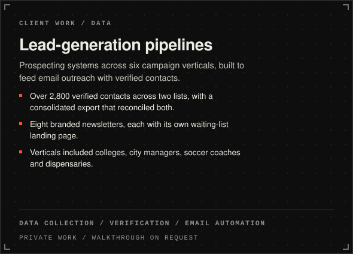

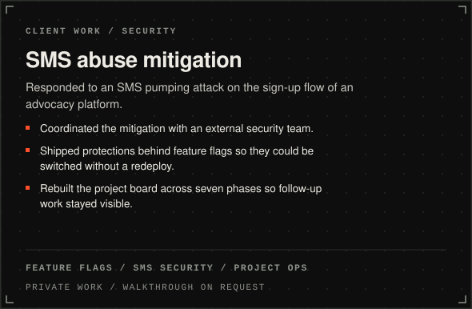 <a href="https://github.com/AyorN-cyber/verified-remote-jobs">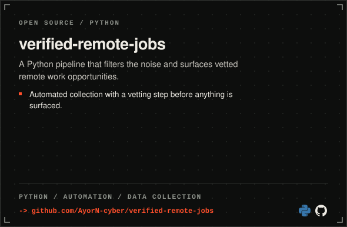</a>

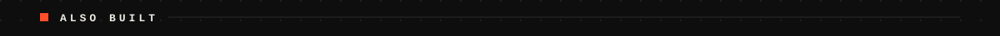

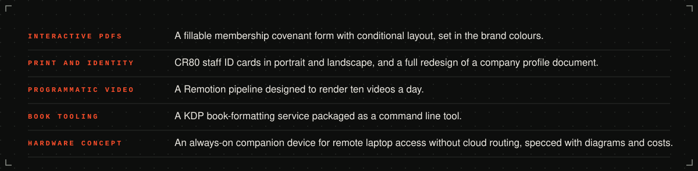

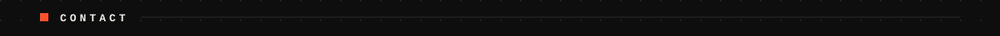

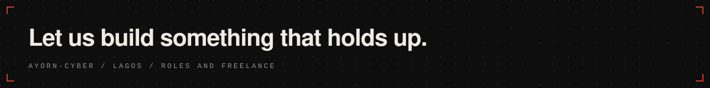

<a href="mailto:ayortechservice@gmail.com">ayortechservice@gmail.com</a> &nbsp;/&nbsp;
<a href="https://linkedin.com/in/ayomide-olabisi-88190120b">LinkedIn</a> &nbsp;/&nbsp;
<a href="https://github.com/AyorN-cyber">GitHub</a> &nbsp;/&nbsp;
<a href="https://winnowhq.online">winnowhq.online</a>

